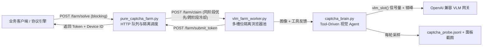

# Blacklight VLM Solver — 解耦式视觉 Agent 黑灯打码农场

> 一套将 **人机验证（hCaptcha）渲染与浏览器行为隔离**、通过 **HTTP 队列解耦 + Tool-Driven 多模态视觉 Agent** 自动或半自动求解人机挑战与设备指纹协同的工程范本。

[](LICENSE)

---

## 核心设计理念

1. **物理与域名解耦（Pure Captcha Farm）**
   - 打码页面仅渲染干净的独立 `hCaptcha` 容器（可自定义 `HCAPTCHA_SITEKEY`），与业务目标页面零耦合；
   - 业务侧通过纯 HTTP 协议向 `POST /farm/solve` 阻塞取票，无需在协议引擎内嵌入庞杂的浏览器驱动。
2. **并发槽位池 + 跨阶段隔离冷却**
   - 支持多 Worker 并发抢单（`POST /farm/claim`）与 `account_seed` 级别指纹隔离；
   - 同阶段（如 `register` vs `register`）允许短错峰并发排队（`FARM_SAME_STAGE_GAP_S`），而同 `seed` 或同 Worker 跨阶段（`register` → `login`）强制执行冷却与域存储清理，防止风控关联。
3. **Tool-Driven 视觉推理 Agent（`captcha_brain.py`）**
   - 模型自主决策工具调用：`locate` / `sheet` / `zoom` / `solve_pair` / `commit(cells|ids|points|drag)` / `wait`；
   - **内置抗干扰视觉预处理**：
     - 3×3 九宫格直接通过 `cells=[1..9]` 映射至固定格心，消除坐标心算幻觉；
     - 同心圆莫尔纹与迷彩纹理消除 + 黑帽缝线对比表增强；
     - 水平周期扫描线自动检测与 `k=10` 垂直平滑去横纹图②（坐标与红刻度尺 1:1 对齐）；
     - 零距离原地拖拽拦截护栏（`|Δ| < 0.04` 立即退回重写，避免浪费页面提交通道）。
4. **多通道 VLM 并发治理与 CDP 互斥**
   - 通过共享信号量 `vlm_slot()` 与错峰延迟 `VLM_STAGGER_SECONDS` 控制视觉接口并发；
   - 通过页面级 CDP 锁 `_get_cdp_lock(page)` 保护同一浏览器 Tab 下的并发截图、点击与 JS 读取不互相抢占。
5. **结构化题型探针（`captcha_probe.jsonl`）**
   - 自动记录每轮挑战的 iframe 题干、题型分类（`drag_letter_scanline` / `drag_puzzle` / `grid_3x3` / `pair_match`）、去横纹特征指标、VLM 动作、耗费轮次与裁剪面板截图路径，便于离线统计各题型过题率与 Bad Case 复盘。

---

## 架构总览



---

## 模块清单

| 文件 | 职责说明 |
| :--- | :--- |
| `pure_captcha_farm.py` | 独立 HTTP 任务队列、抢单隔离调度、租约超时回收、独立题面 HTML 容器 |
| `vlm_farm_worker.py` | 多槽位 DrissionPage 浏览器池、孤立浏览器种子管理、人工/VLM 双模接入 |
| `captcha_agent.py` | VLM 多通道适配器、共享并发信号量、页面级 CDP 锁与基础浏览器操作原语 |
| `captcha_brain.py` | 工具驱动解题主循环、`3×3` 格心映射、去横纹/去莫尔纹预处理与 `captcha_probe.jsonl` 探针 |
| `captcha_shapes.py` | 同形图形配对两段式定位与拼表辅助 |
| `_secrets.py` | `环境变量 > secrets.json > 默认值` 分层配置读取 |

---

## 快速开始

### 1. 安装依赖

```bash
pip install -r requirements.txt
cp secrets.example.json secrets.json
```

编辑 `secrets.json`（或设置对应环境变量 `VLM_BASE_URL` / `VLM_API_KEY` / `VLM_MODEL` / `PROXY_URL`）：

```json
{
  "proxy_url": "http://127.0.0.1:7890",
  "vlm_base_url": "http://127.0.0.1:8000/v1/chat/completions",
  "vlm_api_key": "sk-your-key",
  "vlm_model": "deepseek-v4.1-flash"
}
```

### 2. 启动打码农场与多槽位 Worker

```bash
# 终端 1：启动 HTTP 农场队列 (默认 :9527)
python pure_captcha_farm.py

# 终端 2：启动 2 并发 VLM Worker（加 --no-vlm 可切换为人工在可见窗口点选）
python vlm_farm_worker.py --workers 2 --farm-url http://127.0.0.1:9527
```

### 3. 业务端取票示例

```python
import requests

resp = requests.post(
    "http://127.0.0.1:9527/farm/solve",
    json={
        "email": "demo@example.com",
        "scenario": "register",
        "account_seed": "seed_001",
        "timeout": 180,
    },
    timeout=195,
)
print(resp.json())  # {"ok": True, "token": "P1_...", "device_id": "..."}
```

### 4. 查看新题型探针统计

```python
import captcha_brain
print(captcha_brain.get_captcha_probe_summary(limit=30))
```

---

## 测试

```bash
pytest -v
```

---

## 免责声明

本项目仅用于 **多模态 Agent 工具编排、浏览器并发隔离调度与验证码抗干扰预处理** 的技术研究与工程教学，请勿用于任何违反目标服务条款或法律法规的自动化滥用场景。
